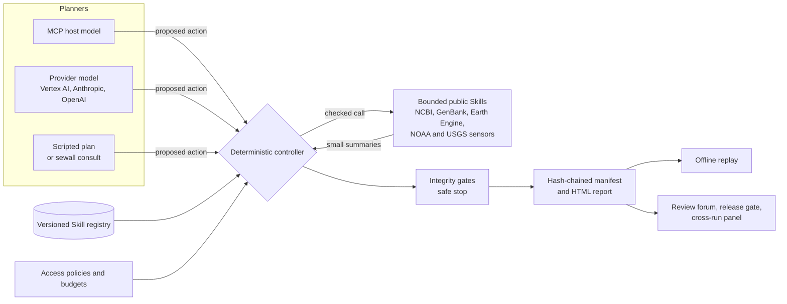
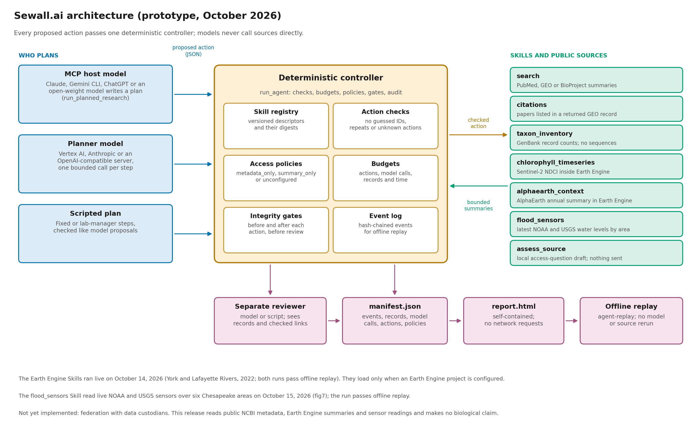
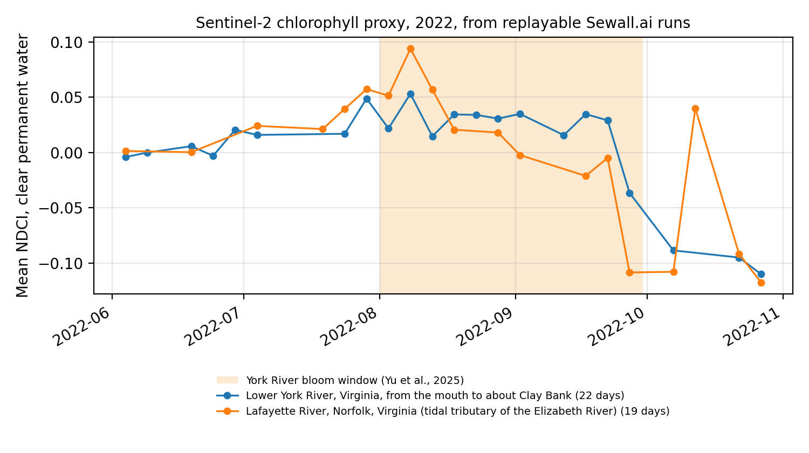
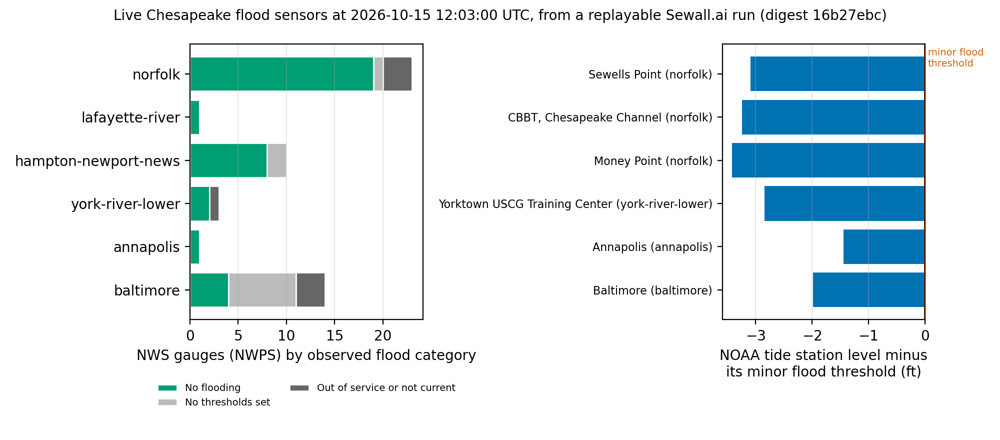
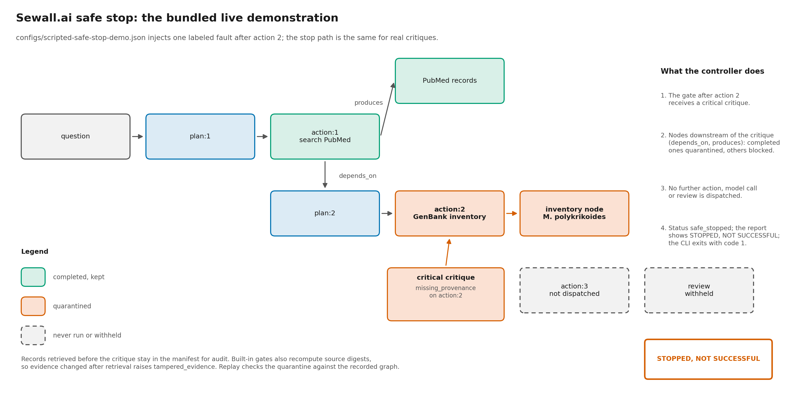

# Sewall.ai

Sewall.ai is a research prototype toward a federated, policy-aware, model-agnostic agentic
data harness for biology. Existing public datasets stay with their repositories and custodians.
This release runs over public NCBI metadata and Earth Engine summaries; federation with data
custodians is not yet implemented.
Bounded agents plan and review research over those holdings through versioned scientific
Skills. Every action and source response is recorded, and every result can be inspected and
replayed offline. The prototype demonstrates software behavior on public metadata and
summaries. It establishes no biological finding.

Developed at the School of Data Science and Department of Computer Science, Old Dominion
University. Released under the Apache License 2.0.

Project page and recorded-run gallery: <https://qinlab.github.io/sewall.ai/>

## Initial knowledge map

Open [`site/knowledge-map/index.html`](site/knowledge-map/index.html) for a self-contained,
searchable graph of NOAA/weather, NEON, seven NCBI databases, EOL, Earth Engine/GCP and
supporting sources. The October 23, 2026 snapshot has **116 typed nodes and 111 typed edges**.
Its four views expose sources/products, data types, policy reviews and the complete graph;
select a node to inspect its identifiers, evidence references, neighbors and JSON.

The [result and limitations](docs/knowledge-map-results-2026-10-23.md),
[source registry](docs/knowledge-map-source-registry-2026-10-23.json),
[graph JSON](knowledge-map/graph.json) and [schema](schemas/knowledge_map.schema.json)
support inspection and offline replay. The 28 review nodes remain unresolved. Shared data
types establish neither sample identity nor scientific compatibility, and the GCP node is
an unconfigured template. Source-workspace module references and dated metadata-evidence
paths record the catalog's preparation context; they do not assert that those components
or archives are included in this public checkout. Official documentation URLs remain available.

```bash
python3 -m sewall.knowledge_map \
  --registry docs/knowledge-map-source-registry-2026-10-23.json --out knowledge-map
python3 -m sewall.knowledge_map --verify knowledge-map/graph.json \
  --registry docs/knowledge-map-source-registry-2026-10-23.json
python3 -m unittest discover -s tests -p test_knowledge_map.py -v
node tests/knowledge_map_viewer.cjs knowledge-map/index.html
# Requires the validation extra and Node.js:
python3 scripts/check_knowledge_map.py --node node
```

The graph is a separate catalog format from execution manifests. It makes no source/model
requests or access decisions. Generated figures are grouped projections of the same JSON.
The Pages workflow publishes the map with the website when this change reaches main.

## How a run works





More figures, with full captions, are in [`docs/figures/`](docs/figures/README.md).

## Quick start

Python 3.10 or later. The core package uses only the standard library.

```bash
git clone https://github.com/QinLab/sewall.ai.git
cd sewall.ai
pip install ".[validation]"
sewall --version
sewall demo --out output/coastal           # offline fixture graph and HTML report
sewall agent --script configs/scripted-bloom-demo.json \
  --question "What public evidence exists on Margalefidinium polykrikoides blooms?" \
  --out output/scripted-bloom             # live NCBI requests, no model keys
sewall agent-replay output/scripted-bloom/manifest.json
```

Open `report.html` in each output directory. Reports make no network requests. Use a new
output directory for each run; existing reports and manifests are never overwritten.

Optional extras: `vertex` (Vertex AI), `mcp` (the MCP server), `validation` (JSON Schema
checks) and `earthengine` (the Earth Engine client). The Anthropic and OpenAI providers need no
extra package. A container image is also defined:

```bash
docker build -t sewall . && docker run --rm sewall demo --out /tmp/demo
```

## What it does

- **Versioned scientific Skills.** Each live action is a JSON descriptor in `skills/live/`
  (schema `schemas/executable_skill.schema.json`) bound to an allowlisted implementation. The
  planner prompt and argument checks are generated from the descriptors. A descriptor can
  narrow an implementation's allowed values but cannot widen them, add code, add endpoints or
  grant permissions. Each manifest records the Skill versions and descriptor digests.
- **Model-driven research with a separate reviewer.** A planner chooses Skill actions, and a
  separate reviewer assesses the result. The controller rejects guessed identifiers,
  unsupported links, repeated requests and unknown actions, and enforces budgets for actions,
  model calls, records and time.
- **Keyless scripted planner.** A fixed action script drives the same controller, with every
  step checked exactly as a model proposal would be. A script cut short by the action budget
  ends as `budget_exhausted`, and a step whose `$record:` reference finds no record fails the
  run; neither is reported as completed.
- **Compute where the data are held.** Earth Engine Skills reduce satellite imagery inside
  Earth Engine and return only small summaries. Recorded live runs over the York and Lafayette
  Rivers for 2022 are in the gallery.
- **Expert consultation.** `sewall consult` asks rule-based dataset experts (NCBI, Earth Engine,
  EOL, growth models) and writes a capped, ordered plan script for the controller.
- **Research-integrity safe stop.** Integrity gates run before and after every action. A
  critical critique quarantines affected outputs, withholds the review and records the run as
  "stopped, not successful."
- **Offline replay.** `agent-replay` checks digests, rebuilds the graph from recorded events
  and rechecks evidence links without repeating model inference or source queries. The saved
  question, budgets, plan, Skill digests, access policies, request drafts and metrics must
  match the hash-chained events.
- **Review after the run.** A peer-review forum, an FMEA-style release gate and a cross-run
  critique panel work offline on recorded manifests. Each output is hash-chained to its inputs
  and has a verify command. Records can be signed with an Ed25519 key.
- **MCP tools.** Any MCP-compatible host (Claude, Gemini CLI, ChatGPT, open-weight models) can
  drive the same bounded controller.

Design principles carried through the code: source holdings remain authoritative; the harness
never sends, signs or accepts data-use agreements; unknown or unverified access terms block
record use; abstention is a valid outcome; and hashes check consistency but are not signatures
or proof of custodian authenticity.

## Skills

| Action | Skill | Bounded operation |
| --- | --- | --- |
| `search` | `ncbi.metadata-search` | Search PubMed, GEO (`gds`) or BioProject; fetch small public document summaries |
| `citations` | `ncbi.gds-citations` | Retrieve publications explicitly listed in a returned GEO record |
| `taxon_inventory` | `genbank.taxon-inventory` | Count GenBank nucleotide records for one taxon, separating transcriptome assembly (TSA) contigs and counting by marker (LSU, SSU, ITS, COI), and summarize a few records with strain, location and date qualifiers; no sequences |
| `fetch_markers` | `genbank.fetch-markers` | Fetch at most 100 public non-TSA GenBank records of one marker for one taxon; sequences stay in the run record and the planner sees only summaries |
| `assign_ribotype` | `genotype.assign-ribotype` | Assign each fetched sequence to the nearest ribotype in a curated, versioned reference panel by deterministic k-mer similarity |
| `link_strains` | `genotype.link-strains` | Match strains from a curated table of published growth experiments to fetched records by strain or isolate name and report their ribotype calls |
| `chlorophyll_timeseries` | `gee.s2-chlorophyll-timeseries` | Earth Engine only: mean NDCI, a chlorophyll proxy, over one Sentinel-2 mosaic per day at a named site, masked to JRC Global Surface Water permanent water and Cloud Score+ clear pixels; no value below 100 water pixels |
| `alphaearth_context` | `gee.alphaearth-context` | Earth Engine only: annual mean of the 64 AlphaEarth embedding bands over a named site |
| `flood_sensors` | `noaa-usgs.flood-sensors-area` | Latest public water level per sensor over a named Chesapeake Bay area: NOAA NWPS flood categories, NOAA CO-OPS tide levels against flood thresholds, USGS gage height; stale readings are listed apart from current flooding |
| `assess_source` | `sewall.source-capability-assessment` | Record a missing source capability and draft local access questions |
| `finish` | built in | Propose a metadata map and evidence gaps for the separate review call |

## Model providers

`sewall agent --config PLANNER.json --reviewer-config REVIEWER.json` accepts Vertex AI,
Anthropic or OpenAI configurations. Examples are in `configs/models/`:

```json
{"provider": "anthropic", "model": "claude-sonnet-5", "max_output_tokens": 2048, "retries": 0}
```

Keys come from the environment at request time: `ANTHROPIC_API_KEY` or `OPENAI_API_KEY`, or a
variable named by `api_key_env`. A configuration names the variable and never holds the key, and
no key is written to a manifest or an error message. Each call is one HTTPS request with
redirects refused and no retry. OpenAI-compatible servers such as vLLM or Ollama are reached
with `base_url` (see `configs/models/ollama.json`); plain HTTP is accepted only on the loopback
interface, and loopback requests bypass any configured proxy. A configuration with `base_url`
sends a key only from a variable it names in `api_key_env`, so `OPENAI_API_KEY` never reaches
another server. The MCP tool `research_public_metadata` rejects `base_url` and `api_key_env`,
so an MCP host cannot redirect the server owner's keys. A file without a `provider` field is a Vertex AI configuration using Application
Default Credentials (see `configs/example-gemini.json`).

The model names in the examples are illustrations; check each provider's current model list.
The Anthropic and OpenAI clients are tested against recorded response shapes only and have not
yet been run against the live APIs. Only the question and bounded public metadata are sent to
the selected providers. Do not put confidential information in the question.

Set `NCBI_API_KEY` to raise the NCBI rate limit; it is never written to a manifest.

## Earth Engine Skills

The planner names a site from a fixed list (`lafayette-river` in Norfolk, Virginia, and
`york-river-lower`, both approximate bounding boxes); it cannot supply a geometry, a collection
or code. Each action issues one Earth Engine request, and the manifest records the
collection, window or year, scale, mask, scene identifiers, versions, attribution and a
digest of the returned
summary. The Earth Engine project ID is never recorded. The Skills join the registry only when
Earth Engine is configured:

```bash
pip install ".[earthengine]"
earthengine authenticate              # or service-account credentials
export EARTHENGINE_PROJECT=YOUR-REGISTERED-CLOUD-PROJECT
```

Earth Engine use requires a Cloud project registered for Earth Engine and is subject to its
terms and quotas. NDCI is a chlorophyll proxy: it does not identify a species or confirm a
bloom. AlphaEarth dimensions are learned features, not physical measurements. The unit tests
use simulated Earth Engine responses; the York and Lafayette runs in `gallery/runs/` made live
Earth Engine requests on October 16, 2026.



Each point is one day's mosaic, screened per pixel with Cloud Score+ and masked to JRC Global
Surface Water occurrence of at least 90%. The shaded band marks the August to September window
of a simulated York River *M. polykrikoides* bloom (Yu et al. 2025). Both runs pass offline
replay. NDCI does not identify a species or confirm a bloom.

## Flood sensors

`flood_sensors` reads the latest public water levels from NOAA and USGS over a named Chesapeake
Bay area, from Norfolk to Baltimore. It needs no key.

```bash
sewall agent --script configs/scripted-flood-sensors-chesapeake.json \
  --question "Which Chesapeake Bay water-level sensors are at or above flood stage now?" \
  --out output/flood
```



Readings are provisional. USGS series carry no flood thresholds and are not plotted.

## Safe stop on live runs

```bash
sewall agent --script configs/scripted-safe-stop-demo.json \
  --question "What public evidence exists on Margalefidinium polykrikoides blooms?" \
  --out output/live-safe-stop
sewall agent-replay output/live-safe-stop/manifest.json
```

The script injects one labeled fault after the first GenBank inventory. The run stops, its
affected nodes and their descendants are quarantined, and the report shows "STOPPED, NOT
SUCCESSFUL." A synthetic supervisor demonstration is also available:

```bash
sewall safety-demo --scenario critical_critique --out output/safe-stop
sewall safety-verify output/safe-stop/manifest.json
```



Both exit nonzero for a stopped run so scripts cannot treat it as success. This is not a formal
fail-safe guarantee or a detector of every scientific error. See `docs/safety-supervisor.md`.

## MCP server

```bash
pip install ".[mcp]"
sewall-mcp                                    # stdio
sewall mcp --transport streamable-http        # loopback HTTP, for ChatGPT through a tunnel
```

The [MCP quickstart](docs/mcp-quickstart.md) covers Claude Desktop, Claude Code, Gemini CLI and
ChatGPT. No model key is needed for the main tools: the host model writes a plan, and
`run_planned_research` executes it under the same registry, policy and budget checks.

| Tool | Operation |
| --- | --- |
| `list_skills` | List versioned live Skills, arguments and limitations |
| `run_planned_research` | LIVE: execute the host model's plan of Skill actions on public NCBI metadata |
| `verify_recorded_run` | Verify any fixture, live or safety-demo manifest offline |
| `run_safety_demo` | Synthetic integrity supervisor with a controlled safe stop |
| `propose_research` | Inspect a rule-based synthetic plan |
| `run_fixture` | Run bounded synthetic graph checks |
| `refine_fixture` | Verify and revise a retained fixture graph |
| `verify_fixture` | Check digests and deterministic replay |
| `draft_data_access_request` | Prepare nonbinding requests and counterterms |
| `discover_ncbi_metadata` | Make a live public identifier search |
| `research_public_metadata` | Model-driven research with explicit `planner_config` and optional `reviewer_config` |
| `verify_public_metadata_run` | Verify a retained live trace without external calls |

## Recorded-run gallery

```bash
sewall gallery --catalog gallery/catalog.json --out output/gallery-site
```

The gallery is a static site of recorded runs with no live service. The build refuses the whole
catalog if any manifest fails offline verification or contains a local path, a key, a token or a
cloud project ID. `.github/workflows/pages.yml` builds it under `/gallery/`, adds the landing
page in `site/` and the figures, and deploys the result to GitHub Pages.

A run entry may also name a forum and a gate record, and the catalog may list cross-run
panels. The build verifies each against its manifests and refuses the whole catalog on any
failure.

## Review forum, release gate and cross-run panel

These commands work offline on recorded manifests and make no source query.

```bash
sewall forum gallery/runs/york-2022-jrc.json --out output/york-forum
sewall forum-verify output/york-forum/forum.json gallery/runs/york-2022-jrc.json
sewall risk-gate gallery/runs/york-2022-jrc.json --forum output/york-forum/forum.json --out output/york-gate
sewall risk-gate-verify output/york-gate/risk-gate.json gallery/runs/york-2022-jrc.json \
  --forum output/york-forum/forum.json
sewall panel --run york gallery/runs/york-2022-jrc.json \
  --run lafayette gallery/runs/lafayette-2022-jrc.json --out output/panel
sewall consult "How fast does Margalefidinium polykrikoides grow in the York River?" \
  --script-out output/consult-script.json
```

The forum's default reviewers and the panel's default researchers are deterministic rules with
no model call. `--reviewer-config` and `--panelist-config` add model participants, whose posts
must pass the same citation and target checks. A concern is resolved only by an answer that
cites run evidence the concern did not already cite. The release gate scores each output for
severity, occurrence and detection in the style of an FMEA and holds any output above the
threshold; the ratings are uncalibrated prototype settings ([notes](docs/risk-gate-2026-10-15.md)).
A [comparison on the York run](docs/forum-comparison-2026-10-16.md) sets no forum, the rule
forum, Gemini and Llama reviewers, and an adversarial reviewer side by side.

Replay alone cannot detect an edit that is resealed consistently end to end; a signature can.
`sewall sign` signs a manifest, forum or gate with an Ed25519 key through OpenSSH 8.1 or later,
and `sewall sign-verify` checks it against an allowed-signers file.

## Fixture demonstrations

The fixture controller builds a question-driven graph over synthetic metadata and exercises
failure and review paths:

| Scenario | Expected status | Behavior |
| --- | --- | --- |
| `coastal` | completed | Selected fixture checks pass; scientific claims remain empty |
| `missing-link` | abstained | A taxon match cannot repair missing specimen evidence |
| `policy-review` | needs_review | Unverified authorization blocks record use and produces a draft request |
| `policy-denied` | abstained | Prohibited purpose blocks the affected source |
| `source-failure` | failed | Injected timeout withholds dependent results |
| `future-leakage` | abstained | Feature interval or availability exceeds a historical cutoff |
| `--max-steps 1` | failed | Budget exhaustion stops execution and retains a failure record |

```bash
sewall demo --scenario policy-denied --out output/policy-denied
sewall replay output/policy-denied/manifest.json
sewall discover --database pubmed --query "coastal plant ecology" --limit 3   # live identifiers only
```

## Slurm clusters

On a Slurm host, live commands refuse to run outside a CPU allocation. `scripts/cpu_job.sh` is a
launcher, and `docs/live-validation-2026-09-10.md` records the original cluster validation.

## Repository layout

| Path | Contents |
| --- | --- |
| `sewall/` | Package: live controller (`agent.py`), Skill registry (`skills.py`), scripted planner, expert consultation (`experts.py`), model providers (`llm.py`, `providers.py`), NCBI and GenBank adapters, ribotype assignment and strain linkage (`ribotype.py`, `strains.py`, curated panels in `panels/`), Earth Engine Skills (`earthengine.py`), flood sensors (`floodsensors.py`), policy checks, safe-stop supervisor, review forum, release gate, cross-run panel, signing, fixture graph, HTML report, gallery, MCP server, CLI |
| `skills/` | Live Skill descriptors (`skills/live/`) and the fixture Skill descriptor |
| `schemas/` | JSON Schemas for manifests and Skill descriptors |
| `configs/` | Model configurations, MCP host configurations and scripted demonstrations; no credentials |
| `gallery/` | Recorded reference runs and the gallery catalog |
| `scripts/` | Smoke test, Slurm launchers, validation drivers and figure scripts |
| `tests/` | Unit tests with mocked networking; they never contact NCBI, Earth Engine, NOAA, USGS or a model |
| `docs/` | MCP quickstart, source interfaces and limits, safe-stop design, validation and results records, figures |

## Tests

```bash
pip install ".[validation,mcp]"
python3 -m unittest discover -s tests -t tests
```

Schema tests skip without `jsonschema` and MCP tests skip without the MCP SDK. GitHub Actions
runs the suite on Python 3.10, 3.12 and 3.13, checks an installed wheel and builds the image.

## Limitations

This is a small, bounded controller, not a scientific workflow engine. It retrieves public
metadata and small summaries only: no expression matrices, participant genotypes, article
abstracts or full text. Marker sequences are fetched only by `fetch_markers`, at most 100 public
records per step, and stay in the run record. Controlled-access sources, custodian federation, production isolation,
durable checkpointing and real grant verification are not implemented. Requests for
unconfigured sources become local, nonbinding drafts. Review text is a model assessment;
citations and quote matches do not validate all its reasoning. Even a completed run has zero
validated scientific claims. Cross-model scientific performance is not measured. Validation
records in `docs/` describe software behavior at the recorded dates.

## Citing

Citation metadata is in [`CITATION.cff`](CITATION.cff). A DOI will be minted through Zenodo for
tagged releases and added here. Until then, cite the repository URL and version.

## License

Apache License 2.0. See [`LICENSE`](LICENSE).
