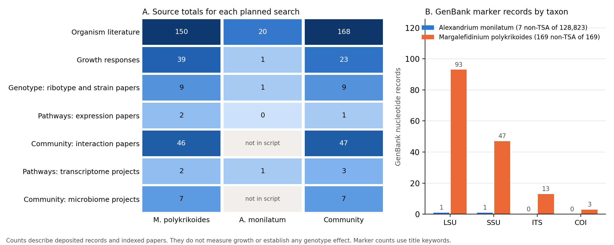

# Growth-model consultation: preliminary results (2026-10-15)

This memo reports three live runs of the Sewall.ai lab manager with the growth-model expert
(`sewall/experts.py`). Each run asked
a growth or community question. The lab manager wrote a fixed script from the expert
consultations. The bounded controller ran the script against live NCBI services and recorded a
hash-chained manifest. Offline replay verified every manifest.

These are evidence-discovery results. They count papers, projects and sequence records that could
inform each term of the planned model, dN/dt = mu_max f_T f_S f_I f_N N - losses. No growth
parameter was estimated, and no genotype effect was tested.

## Runs

| Run | Question | Steps | Records | Events | Manifest digest | Replay |
|---|---|---|---|---|---|---|
| mpoly-growth | How do temperature, light and grazing affect growth of *Margalefidinium polykrikoides*, and which genotypes and pathways matter for a growth model? | 9 | 12 | 220 | `f61df236` | valid |
| amon-growth | Which temperature, salinity and nutrient responses, genotypes and pathways should parameterize a growth model for *Alexandrium monilatum*? | 7 | 4 | 143 | `b6842f86` | valid |
| community | How do competition, allelopathy and bacteria shape growth of *M. polykrikoides* and *A. monilatum* in a community interaction model? | 10 | 12 | 238 | `58916503` | valid |

amon-growth ran on October 15 with `--max-actions 8 --max-model-calls 10 --max-records 15
--per-search 2 --max-seconds 600`. On October 15, the 8-step cap deferred one step of mpoly-growth
and two of community. After the cap rose to 16, both questions were planned again and rerun on
October 16 with the plan's suggested limits (9 actions and 11 model calls, and 10 and 12) and
`--max-records 30 --per-search 2 --max-seconds 600`. Nothing was deferred. Every search total
that both versions ran was unchanged. The October 15 runs had digests `9c2af33a` and `897b6125`
and are kept in `output/growth-consult/old-8step/`. Replay re-ran no model call and no source
request. Plans, manifests, HTML reports and replay results are in `output/growth-consult/`, which git ignores;
the digests above identify them.

## Figure

`figures/growth-consult-evidence-2026-10-15.png`, made by `scripts/plot_growth_consult.py` from the
three manifests. The values are in `figures/growth-consult-evidence-2026-10-15.csv`. Panel A shows the source total for each planned search, grouped
by the model input it informs. Panel B shows GenBank marker records per taxon. "Not in script"
means the expert did not propose that search for the question.

## Findings

1. **M. polykrikoides has enough evidence to start a growth model.**
   - PubMed returned 39 growth-response papers and 46 community-interaction papers.
   - The retrieved records include a 2025 temperature and salinity growth study of the Virginia
     Group III strain (PMID 40409864) and a 2024 diel vertical migration study from the lower
     Chesapeake (PMID 39606117).
   - It also returned a bacterial algicide study, *Fictibacillus* sp. 5A8M (PMID 39947867).
     Bacterial effects belong in the loss term.
2. **Genotype assignment is feasible for M. polykrikoides.**
   - GenBank holds 169 records, none of them TSA: 93 LSU, 47 SSU, 13 ITS and 3 COI.
   - LSU is the marker used to define the Group I to IV ribotypes, so the planned
     `genotype.assign-ribotype` Skill has data to work on.
3. **Pathway evidence is thin for both species.**
   - Only 2 expression papers matched for M. polykrikoides, both on *C. polykrikoides* from 2015
     and 2016: a genome-wide transcriptome response (PMID 26732698) and HSP70/HSP90 genes
     (PMID 26064872).
   - Two transcriptome projects exist: strain CP-01 (PRJNA257950) and an *Erythrobacter*
     co-culture (PRJNA766743).
   - This supports a qualitative mechanism for f_T. It cannot supply rate parameters.
4. **A. monilatum is sparse.**
   - PubMed has 20 organism papers, 1 growth-response paper and no pathway papers.
   - GenBank lists 128,823 records, but 128,816 are TSA contigs. Only 7 are not TSA, with
     1 LSU and 1 SSU.
   - The only transcriptome project found is the MMETSP umbrella (PRJNA647089).
   - A per-genotype A. monilatum model is not supported by public data today. It would need
     new strain experiments, which are out of scope for this solicitation, or partner data.
5. **Community data exist for the interaction model.**
   - The community question found 47 interaction papers.
   - One of them is an allelochemical study of A. monilatum against other phytoplankton
     (PMID 39567060), which gives the competition term a direct source.
   - The M. polykrikoides run found 7 microbiome or metabarcoding projects, including York
     River bloom microbiomes (PRJNA731462) and Korean red-tide zooplankton metabarcoding
     (PRJNA1024072).
   - The community run on October 16 searched microbiome projects for both taxa and found the
     same 7. No public BioProject matched A. monilatum with microbiome, 16S, metagenome or
     metabarcoding terms. The 8-step cap had deferred this search on October 15.

## Operational issue and fix

The first two attempts at mpoly-growth and community failed mid-run with NCBI HTTP 429 and
URLError. The same queries succeed when sent alone. The Waterfield compute nodes share one public
IP, and keyless E-utilities allow three requests per second per IP. The in-process spacing was
0.35 s, which gives no margin when other jobs on the same IP also call NCBI.

The fix is `ncbi.MIN_INTERVAL_SECONDS = 0.5`, shared by `ncbi.py`, `evidence.py` and the keyless
path in `genbank.py`. The test for the shared rate budget now derives its expectation from that
constant. With the change, all runs completed. The full suite passes: 297 tests, 1 skipped.
Failed attempts are kept as `*-attempt1` and `*-attempt2` for the record.

An `NCBI_API_KEY` raises the limit to 10 requests per second. `ncbi.py`, `evidence.py` and
`genbank.py` all send it when it is set, and space keyed requests 0.12 s apart.

## Caveats

- Search totals are counts of indexed records for a query on one day. They are not a measure
  of evidence quality, and they change as the databases grow.
- Marker counts match title keywords and are approximate.
- Each search kept at most 2 records (`--per-search 2`). In the M. polykrikoides run, the
  ribotype search had 9 hits, but its top 2 were already retrieved, so it added no new record.
- The expert is rule-based. A different wording of the question can change which factors it
  detects and which searches it proposes.

## Next steps

1. Implement `genbank.fetch-markers` and `genotype.assign-ribotype`, and run them on the 93
   M. polykrikoides LSU records.
2. Extract growth parameters (Topt, salinity bounds, mu_max) from PMID 40409864 and the other
   growth-response papers into a versioned trait table with citations.
